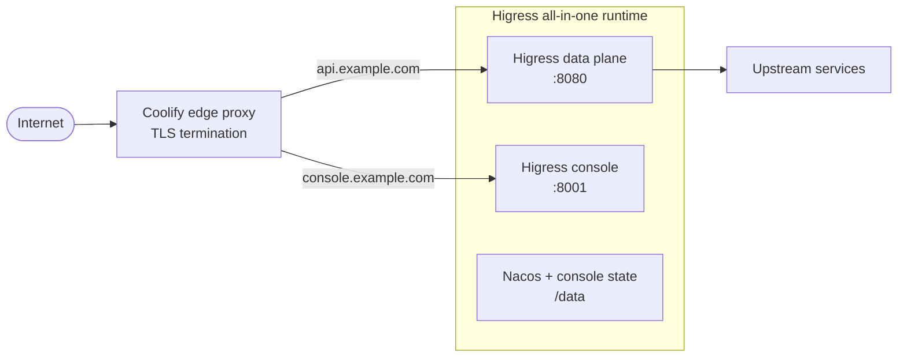

# Higress Coolify Reference Architecture

> Production-oriented reference architecture for operating Higress AI Gateway on a
> single Coolify-managed Docker host.


**Status:** active reference implementation for single-node Coolify deployments.

**Documentation:** [docs/README.md](docs/README.md)

## Назначение

Репозиторий описывает воспроизводимую модель развёртывания Higress для команд,
которым нужен управляемый edge-шлюз, независимый жизненный цикл кастомных
Wasm-плагинов и предсказуемая эксплуатация — без операционной стоимости
Kubernetes.

Это не «ещё один docker-compose для локального запуска». Это фиксированный
deployment-контракт:

- публичный ingress принадлежит Coolify;
- Higress data plane и control plane разведены по разным портам;
- состояние вынесено из контейнера в named volume;
- версия runtime-образа фиксируется по digest;
- плагины распространяются как версионированные OCI-артефакты;
- backup, preflight и smoke-test являются частью репозитория, а не устной
  договорённостью.

## Архитектура



| Компонент | Роль | Контур |
|---|---|---|
| Coolify edge proxy | TLS, маршрутизация, выпуск сертификатов | Публичный |
| Higress data plane | Envoy, маршруты, политики, AI-трафик | Внутренний `:8080` |
| Higress console | Control plane, конфигурация, плагины | Внутренний `:8001` |
| All-in-one runtime | Envoy, controller, console, встроенный Nacos | Один контейнер |
| Named volume | Состояние Nacos и консоли | `/data` |

Порт `8443` остаётся доступным внутри Docker-сети для сценариев end-to-end TLS
и mTLS. Публикация `80/443` на host не предусмотрена: этим контуром управляет
Coolify.

## Принципы

**Edge и control plane разделены.** API-трафик и административная консоль
публикуются разными доменами и на разных портах. Это упрощает сетевые политики
и позволяет ограничивать доступ к control plane независимо от data plane.

**Runtime-образ иммутабелен.** `HIGRESS_IMAGE` обязателен и задаётся тегом с
digest. `latest` не является допустимым production-значением.

**Состояние живёт вне контейнера.** Nacos и данные консоли размещаются в named
volume. Пересоздание контейнера не должно приводить к потере конфигурации.

**Плагины имеют собственный lifecycle.** Кастомные Wasm-плагины публикуются как
OCI-артефакты и подключаются через Higress Console. Пересборка gateway для
каждого плагина не требуется.

**Один узел — осознанный компромисс.** Архитектура рассчитана на небольшие и
средние инсталляции. Она не имитирует HA-поведение Kubernetes и не скрывает
ограничения single-node модели.

## Ключевые решения

| Решение | Обоснование | Компромисс |
|---|---|---|
| Higress all-in-one | Официальный Docker-путь, минимум движущихся частей | Single point of failure |
| Coolify edge proxy | Автоматический TLS и единый ingress-контур | Нет mTLS по умолчанию |
| Named volume | Простое и предсказуемое состояние | Нет HA и автоматического DR |
| OCI-плагины | Независимый lifecycle и откат | Нужен контролируемый registry |
| Digest pinning | Воспроизводимый runtime | Требует дисциплины обновлений |

## Deployment contract

| Параметр | Значение |
|---|---|
| Модель развёртывания | Один Docker-хост, Docker Compose v2 |
| Edge | Coolify proxy, TLS termination |
| Runtime | `higress/all-in-one` |
| Data plane | `8080` |
| Control plane | `8001` |
| Внутренний HTTPS | `8443` |
| Состояние | Named volume, `/data` |
| Плагины | Proxy-Wasm, OCI |
| Backup | Volume snapshot через `scripts/backup.sh` |
| Валидация | `scripts/preflight.sh`, `scripts/smoke-test.sh` |
| Минимальный footprint | 2 vCPU / 2 GB RAM |

## Быстрый старт

### 1. Ресурс в Coolify

Создайте ресурс **Docker Compose**, укажите репозиторий и путь
`/docker-compose.yml`. Публикация портов через UI не требуется: compose уже
содержит `expose`, а ingress обслуживает Coolify.

### 2. Runtime-образ

Зафиксируйте образ по digest:

```bash
./scripts/pin-image.sh \
  higress-registry.cn-hangzhou.cr.aliyuncs.com/higress/all-in-one:<version>
```

Полученное значение используйте в `HIGRESS_IMAGE`.

### 3. Environment contract

```dotenv
HIGRESS_IMAGE=higress-registry.cn-hangzhou.cr.aliyuncs.com/higress/all-in-one:<version>@sha256:<digest>
HIGRESS_CONSOLE_ADMIN_USER=admin
HIGRESS_CONSOLE_ADMIN_PASSWORD=<openssl rand -base64 36>
HIGRESS_CONSOLE_OPENAPI_JWT_SECRET=<openssl rand -base64 48>
HIGRESS_PLATFORM=linux/amd64
TZ=UTC
```

`HIGRESS_CONSOLE_ADMIN_PASSWORD` применяется при первичной инициализации
консоли. Дальнейшая ротация выполняется через UI.

### 4. Маршрутизация

```dotenv
SERVICE_FQDN_HIGRESS_8080=api.example.com
SERVICE_FQDN_HIGRESS_8001=console.example.com
```

Эти переменные создают отдельные proxy-router для data plane и control plane.
Ручные домены для тех же портов дублировать не следует.

### 5. Проверка

```bash
./scripts/preflight.sh
./scripts/smoke-test.sh https://api.example.com https://console.example.com
```

До появления маршрутов ответ `404` от Higress является корректным: важно, что
запрос доходит до gateway, а не теряется на edge-прокси.

## Конфигурация

| Переменная | Обязательна | Назначение |
|---|---:|---|
| `HIGRESS_IMAGE` | да | Immutable runtime image |
| `HIGRESS_CONSOLE_ADMIN_PASSWORD` | да | Первичный пароль администратора |
| `HIGRESS_CONSOLE_OPENAPI_JWT_SECRET` | да | Подпись OpenAPI-токенов |
| `HIGRESS_CONSOLE_ADMIN_USER` | нет | Имя администратора, по умолчанию `admin` |
| `HIGRESS_PLATFORM` | нет | Платформа образа, по умолчанию `linux/amd64` |
| `HIGRESS_VOLUME_NAME` | нет | Имя state volume, по умолчанию `higress-data` |
| `TZ` | нет | Часовой пояс контейнера |
| `JAVA_OPTS` | нет | Параметры JVM для консоли |
| `HIGRESS_CPU_LIMIT` | нет | CPU limit |
| `HIGRESS_MEM_LIMIT` | нет | Memory limit |
| `HIGRESS_CPU_RESERVATION` | нет | CPU reservation |
| `HIGRESS_MEM_RESERVATION` | нет | Memory reservation |
| `SERVER_FORWARD_HEADERS_STRATEGY` | нет | Forwarded headers для работы за TLS-прокси |

Полный шаблон: [`.env.example`](.env.example).

## Маршрутизация и TLS

Coolify терминирует TLS и передаёт трафик в Higress по HTTP. Для корректных
redirects и абсолютных ссылок консоль получает
`SERVER_FORWARD_HEADERS_STRATEGY=framework`.

Для mTLS, end-to-end TLS и части gRPC-сценариев HTTP-роутинг edge-прокси может
быть недостаточен. В таких случаях используется отдельный TCP-путь через
`docker-compose.override.example.yml`, а сертификаты и firewall остаются
ответственностью оператора.

Coolify proxy добавляет `X-Forwarded-For`, однако Higress по умолчанию видит
адрес прокси. Для ACL и rate-limit по клиентскому IP необходимо явно настроить
доверенные hops. Заголовкам от произвольных клиентов доверять нельзя.

## Кастомные плагины

Плагины не встраиваются в runtime-образ. Контракт артефакта:

```text
Proxy-Wasm source
    -> plugin.wasm
    -> OCI image (scratch + /plugin.wasm)
    -> registry
    -> WasmPlugin.url = oci://...
```

Преимущества модели:

- версионирование и откат через digest;
- отсутствие пересборки gateway при изменении плагина;
- единый механизм для Docker и Kubernetes;
- независимый supply chain для плагинов;
- отсутствие зависимости от внутренних путей all-in-one образа.

Сборка и публикация:

```bash
./scripts/build-plugin.sh plugins/example-header \
  ghcr.io/ORG/higress-plugin-example-header:0.1.0
```

Если локальный Go/TinyGo отсутствует:

```bash
BUILD_IN_DOCKER=1 \
./scripts/build-plugin.sh plugins/example-header \
  ghcr.io/ORG/higress-plugin-example-header:0.1.0
```

Регистрация выполняется в **Higress Console → Plugin Market → Custom Plugins**.
Подробный контракт: [docs/plugins.md](docs/plugins.md).

## Эксплуатация

| Процесс | Инструмент |
|---|---|
| Preflight | `scripts/preflight.sh` |
| Deployment | Coolify / `docker compose up -d` |
| Smoke-test | `scripts/smoke-test.sh` |
| Backup | `scripts/backup.sh` |
| Обновление | смена digest + redeploy |
| Откат | предыдущий digest + redeploy |

Перед обновлением runtime-образа создаётся backup state volume. Обновление без
backup считается нарушением эксплуатационного контракта.

Подробный runbook: [docs/operations.md](docs/operations.md).

## Безопасность

- Control plane не предназначен для открытого интернет-доступа. Минимальный
  уровень — сильный пароль; целевой — VPN, IP allowlist или identity-aware proxy.
- Секреты хранятся в Coolify environment variables, а не в Git.
- Runtime-образ фиксируется по digest.
- Плагины публикуются в контролируемый registry и подключаются по immutable
  reference.
- Приватный registry требует image pull secret.
- Docker socket на host должен быть доступен только доверенным операторам.

Политика раскрытия уязвимостей: [SECURITY.md](SECURITY.md).

## Границы применимости

| Входит в scope | Не входит в scope |
|---|---|
| Single-node production | Multi-node HA |
| Docker Compose / Coolify | Kubernetes operator |
| Wasm-плагины через OCI | Нативные Envoy-фильтры |
| Backup и восстановление volume | Managed disaster recovery |
| TLS на edge-прокси | Корпоративный PKI и mTLS по умолчанию |
| Базовая observability | Полный observability stack |

All-in-one не заменяет Kubernetes. При росте требований к HA, rolling upgrades и
multi-tenant control plane архитектура должна быть перенесена в Kubernetes.

## Структура репозитория

```text
.
├── docker-compose.yml                 # Production deployment contract
├── docker-compose.local.yml           # Local verification overlay
├── docker-compose.override.example.yml
├── .env.example
├── docs/
│   ├── README.md                      # Documentation index
│   ├── coolify.md                     # Coolify deployment guide
│   ├── plugins.md                     # Wasm plugin engineering
│   └── operations.md                  # Operations runbook
├── plugins/
│   ├── Dockerfile.plugin              # OCI packaging
│   ├── Dockerfile.plugin-build        # Reproducible in-Docker build
│   └── example-header/                # Reference plugin
├── scripts/
│   ├── preflight.sh
│   ├── pin-image.sh
│   ├── build-plugin.sh
│   ├── backup.sh
│   └── smoke-test.sh
├── SECURITY.md
├── CONTRIBUTING.md
├── CHANGELOG.md
├── LICENSE
└── .github/workflows/
    ├── validate.yml                   # Compose and shell validation
    └── plugin-image.yml               # Plugin artifact release
```

## CI

| Workflow | Назначение |
|---|---|
| `Validate` | Compose model, shell syntax, Makefile interfaces |
| `Plugin artifact` | Сборка и публикация OCI-образа плагина с provenance/SBOM |

## Вклад

Изменения должны сохранять deployment-контракт: immutable runtime image,
разделение data/control plane, внешнее состояние и независимый lifecycle
плагинов. Процесс описан в [CONTRIBUTING.md](CONTRIBUTING.md).

## Acknowledgements

Проект является независимой deployment-референсной архитектурой и не аффилирован
с проектами Higress, Envoy или Coolify. Названия и товарные знаки принадлежат их
правообладателям.

## Лицензия

Apache License 2.0. См. [LICENSE](LICENSE).

---

**Operational ownership.** Этот репозиторий является deployment reference, а не
управляемым сервисом. Эксплуатационная команда отвечает за backup, обновления,
TLS-политику, доступ к control plane и supply chain плагинов.
